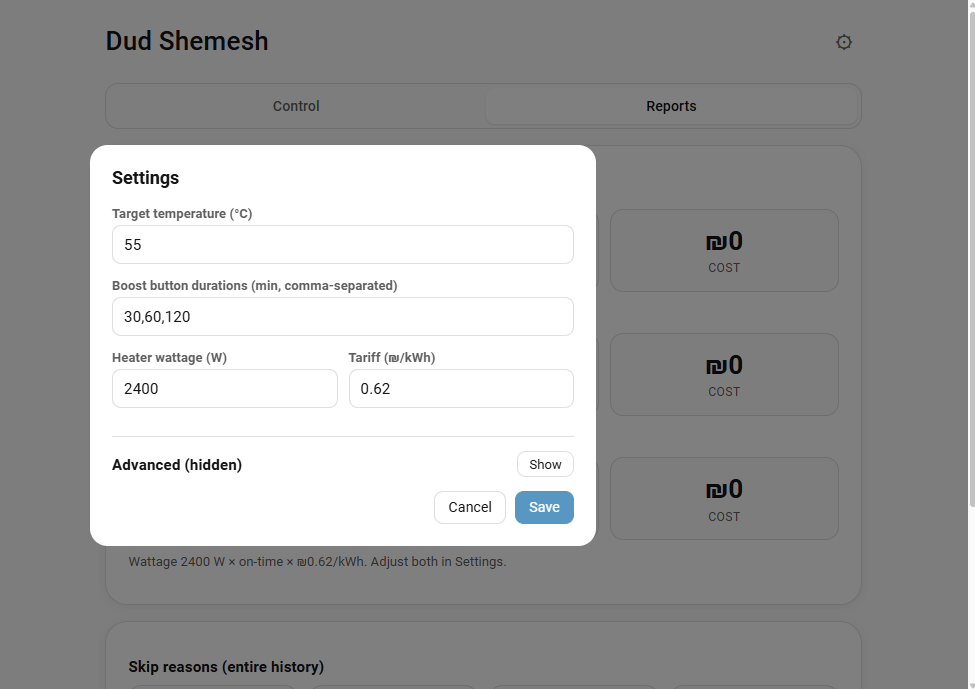

# הגדרות

ההגדרות נמצאות בשני מקומות: חלון **Configure** של האינטגרציה ב-Home Assistant, וכרטיסיית **הגדרות** בפאנל דוד שמש (סמל גלגל השיניים). הגדרות הפאנל זמינות למנהלים בלבד. פעולות יומיומיות (מצב, טמפרטורה רצויה, חימום עכשיו, חופשה) פתוחות לכל המשתמשים.

## מצבים

| מצב | התנהגות |
| --- | ------- |
| **אוטומטי** | מחמם מראש לפני חלונות הנוחות ומריץ גם את לוחות הזמנים. מדלג כשהמים כבר בטמפרטורה הרצויה או כשהשמש עושה את העבודה. |
| **לוח זמנים** | מריץ את לוחות הזמנים בשעות קבועות, ומדלג כשהמים כבר חמים או שהשמש מחממת. זו ברירת המחדל לרשומה חדשה. |
| **כבוי** | ללא חימום אוטומטי. כפתורי ההפעלה המהירה עדיין עובדים. |

## אפשרויות האינטגרציה (חלון Configure)

ממסר חימום, חיישן טמפרטורת המיכל, טמפרטורה רצויה, הספק גוף החימום, נפח המיכל, מחיר חשמל, חלונות נוחות, מצב, ומחזור חיטוי ליגיונלה (פעיל או לא, טמפרטורה, תדירות בימים). חלונות נוחות מוזנים כטווחים בפורמט `HH:MM-HH:MM` מופרדים בפסיקים; כל פורמט אחר נדחה.

## הגדרות הפאנל

ברירות המחדל להלן לקוחות מהקוד.

### בסיסי

| הגדרה | ברירת מחדל | הערות |
| ----- | ---------- | ----- |
| טמפרטורה רצויה | 55 מעלות | גם סמן הגרירה במד משנה את אותו ערך (20 עד 80 מעלות). |
| כפתורי הפעלה מהירה | `30,60,120` | בדקות, מופרדות בפסיקים. אותם משכים מופיעים ככפתורי הארכה בזמן חימום. |
| הספק גוף החימום | 2400 וואט | |
| מחיר בסיס | 0.62 ₪ לקוט״ש | |
| נפח המיכל | 0 (לא ידוע) | משמש להערכת מספר המקלחות. `0` מסתיר אותה. |

### אוטומציה

| הגדרה | ברירת מחדל | הערות |
| ----- | ---------- | ----- |
| צריך מים חמים ב- | ריק | חלונות נוחות למצב האוטומטי. |
| מרווח חימום מקדים | 5 דקות | דקות לפני החלון. |
| ישות יומן | ללא | אירוע שהכותרת שלו מכילה מילת מפתח מפעיל חימום. |
| מילות מפתח | `dud,water,חם,מים,דוד` | כתבו `45m` (דקות) או `55c` (טמפרטורה רצויה) בתיאור האירוע. הערכים מוגבלים ל-1 עד 720 דקות ול-20 עד 80 מעלות. |
| טווח בדיקה | 10 דקות | |

### סולארי

| הגדרה | ברירת מחדל | הערות |
| ----- | ---------- | ----- |
| ישות מזג אוויר | ללא | ישות `weather.*`. |
| דלג כשהמצב הוא | `sunny` | דילוג לפי מזג אוויר לא חל בין השקיעה לזריחה (לפי `sun.sun`). |
| שעות תחזית | 0 | `0` = מצב מזג האוויר הנוכחי בלבד. אחרת התחזית השעתית מכריעה. |
| כיסוי עננים מרבי | 40% | כיסוי עננים שעדיין נחשב שמשי. |
| חיישן תחזית סולארית | ללא | למשל Forecast.Solar או Solcast. מדלגים כשהערך לפחות כערך הסף (ברירת מחדל 1.0). |
| חלון מעקב | 30 דקות | זיהוי חימום סולארי בודק את עליית הטמפרטורה בחלון הזה. |
| סף עלייה | 1.0 מעלות | עלייה בתוך החלון שנחשבת כתרומה של השמש. |

### בטיחות

| הגדרה | ברירת מחדל | הערות |
| ----- | ---------- | ----- |
| כיבוי אוטומטי אחרי הדלקה ידנית | 60 דקות | דוד שהודלק מחוץ ל-Dud Shemesh נקלט כהפעלה ויכובה אחרי הזמן הזה. `0` = מכובה. |
| אורך הפעלה מרבי | 180 דקות | מגביל גם הארכות של הפעלה מהירה. |
| ניתוק בחום יתר | 75 מעלות | |
| חיישן נחשב מנותק אחרי | 120 דקות | `0` = אף פעם. חיישן מנותק מתעלמים ממנו וההפעלות עוברות לפי זמן בלבד. |
| זיהוי תקלה | כבוי | אחרי N דקות (ברירת מחדל 8) הטמפרטורה במיכל צריכה לעלות לפחות ב-N מעלות (ברירת מחדל 1.0), אחרת תתקבל התראה על חימום שלא מעלה טמפרטורה. |
| חיטוי ליגיונלה | כבוי | טמפרטורת מחזור ברירת מחדל 60 מעלות, כל 7 ימים. |

### חופשה ושבת

| הגדרה | ברירת מחדל | הערות |
| ----- | ---------- | ----- |
| חופשה פעילה עד | ללא | לוחות זמנים והפעלות אוטומטיות מושהים עד התאריך הזה. |
| טמפרטורת שמירה | 30 מעלות | מונעת מהמיכל להתקרר לגמרי (נגד עובש). |
| מצב שבת | כבוי | דורש את אינטגרציית הלוח העברי. מחמם לפני הדלקת נרות. אפשרויות: יעד לשבת (`0` = היעד הרגיל), נעילת הבקרה עד ההבדלה, ללא התראות. |

### מחיר

| הגדרה | ברירת מחדל | הערות |
| ----- | ---------- | ----- |
| מחירים לפי שעות | ללא | חלונות כמו `23:00-07:00@0.49`. בשאר השעות חל מחיר הבסיס. |
| הזזת חימום מקדים לשעות זולות | פעיל | מזיז את החימום המקדים לשעות הזולות ביותר שעדיין מספיקות לסיים בזמן. |

### התראות

בוחרים שירות `notify.*` אחד או יותר, ואילו אירועים שולחים התראה:

`heat_start`, `heat_end`, `target_reached`, `heat_not_rising`, `skipped_solar`, `skipped_weather`, `legionella_done`, `safety_stop`, `sensor_stale`, `manual_on`, `cold_warning`.

נוסח ההתראות עוקב אחרי השפה של Home Assistant (עברית או אנגלית). התראות לאפליקציית Companion (`mobile_app_*`) כוללות כפתורי פעולה: חימום עכשיו, הפעלה מהירה לשעה, להשאיר 30 דקות, כיבוי.
