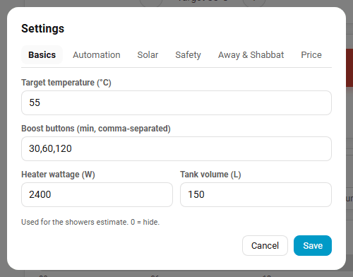
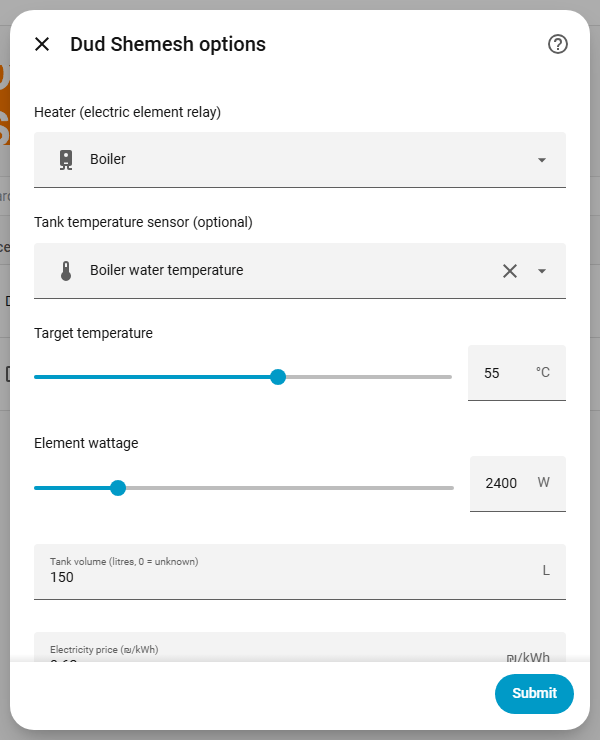

# Configuration

Settings live in two places: the integration's **Configure** dialog in Home Assistant, and the **Settings** tab of the Dud Shemesh panel (the gear icon). Panel settings are for admins only. Everyday controls (mode, target temperature, heat now, vacation) work for every user.

## Modes

| Mode | Behaviour |
| ---- | --------- |
| **Auto** | Pre-heats ahead of your comfort windows and also runs your schedules. Skips when the tank is already at target or the sun is doing the job. |
| **Schedule** | Runs your schedules at fixed times, skipping when the tank is already warm or the sun is heating it. This is the default for a new entry. |
| **Off** | No automatic heating. The boost buttons still work. |

## Integration options (Configure dialog)

Heater, tank temperature sensor, target temperature, element wattage, tank volume, electricity price, comfort windows, mode, and the anti-Legionella cycle (on or off, temperature, interval in days). Comfort windows must be `HH:MM-HH:MM` ranges separated by commas; anything else is rejected.

## Panel settings

Defaults below come from the code.

### Basics

| Setting | Default | Notes |
| ------- | ------- | ----- |
| Target temperature | 55 °C | The drag marker on the gauge changes the same value (20 to 80 °C). |
| Boost buttons | `30,60,120` | Minutes, comma-separated. The same durations appear as extend buttons while heating. |
| Heater wattage | 2400 W | |
| Base price | 0.62 ₪/kWh | |
| Tank volume | 0 (unknown) | Used for the showers estimate. `0` hides it. |

### Automation

| Setting | Default | Notes |
| ------- | ------- | ----- |
| Hot water needed at | empty | Comfort windows for Auto mode. |
| Pre-heat margin | 5 min | Minutes before the window. |
| Calendar entity | none | Events whose title contains a keyword start a heat run. |
| Keywords | `dud,water,חם,מים,דוד` | Put `45m` (minutes) or `55c` (target temperature) in the event description. Values are clamped to 1 to 720 min and 20 to 80 °C. |
| Look ahead | 10 min | |

### Solar

| Setting | Default | Notes |
| ------- | ------- | ----- |
| Weather entity | none | A `weather.*` entity. |
| Skip when state is | `sunny` | Weather skip is never applied between sunset and sunrise (uses `sun.sun`). |
| Forecast hours | 0 | `0` = current weather state only. Otherwise the hourly forecast decides. |
| Max cloud cover | 40 % | Cloud cover still counted as sunny. |
| Solar forecast sensor | none | For example Forecast.Solar or Solcast. Skip when the value is at least the threshold (default 1.0). |
| Track window | 30 min | Solar gain detection watches the temperature rise over this window. |
| Rise threshold | 1.0 °C | Rise within the window that counts as the sun contributing. |

### Safety

| Setting | Default | Notes |
| ------- | ------- | ----- |
| Auto-off after manual turn-on | 60 min | A heater switched on outside Dud Shemesh is adopted as a run and turned off after this time. `0` = off. |
| Maximum run length | 180 min | Also caps boost extensions. |
| Over-temperature cutoff | 75 °C | |
| Treat sensor as stale after | 120 min | `0` = never. A stale sensor is ignored and runs fall back to time only. |
| Fail detection | off | After N minutes (default 8) the tank must have risen by at least N °C (default 1.0), otherwise you get a heat-not-rising alert. |
| Anti-Legionella | off | Cycle temperature default 60 °C, every 7 days. |

### Away and Shabbat

| Setting | Default | Notes |
| ------- | ------- | ----- |
| Vacation active until | none | Schedules and auto runs are suspended until that date. |
| Hold temperature | 30 °C | Keeps the tank from going fully cold (anti-mold). |
| Shabbat mode | off | Needs the Jewish Calendar integration. Heats before candle lighting. Options: Shabbat target (`0` = normal target), lock the controls until havdalah, no notifications. |

### Price

| Setting | Default | Notes |
| ------- | ------- | ----- |
| Time-of-use prices | none | Windows like `23:00-07:00@0.49`. Other hours use the base price. |
| Move auto pre-heat to cheaper hours | on | Moves the pre-heat to the cheapest hours that still finish in time. |

### Notifications

Pick one or more `notify.*` services and which events send a push:

`heat_start`, `heat_end`, `target_reached`, `heat_not_rising`, `skipped_solar`, `skipped_weather`, `legionella_done`, `safety_stop`, `sensor_stale`, `manual_on`, `cold_warning`.

Texts follow the Home Assistant language (English or Hebrew). Companion-app (`mobile_app_*`) notifications get action buttons: Heat now, Boost 1 h, Keep 30 min, Turn off.
