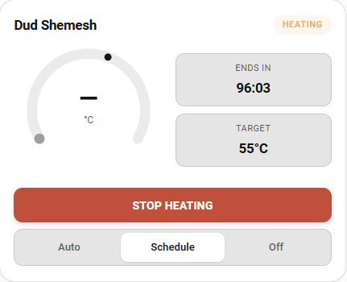

# יכולות

## הפאנל


- מד מעגלי עם סמן יעד שאפשר **לגרור**, וכפתורי הורדה והעלאה של היעד. המד הוא גם מחוון שנשלט במקלדת (חצים, Page Up/Down, Home/End).
- תג מצב: מוכן, מחמם, ממתין, סולארי או קר. בזמן חימום מוצג גם מקור ההפעלה, למשל "מחמם · הפעלה מהירה".
- שורת **החימום הבא**, למשל "חם עד 06:30" או "מקלחת בוקר · מחר 06:15, בעוד 17 ש׳ 20 ד׳".
- הערכת **מספר המקלחות**, כשנפח המיכל מוגדר.
- כדורי מידע בצד: מסתיים בעוד, עד היעד, מקלחות, מצב ומועד חיטוי הליגיונלה הבא.
- כפתורי **הפעלה מהירה**. הפעלה מהירה בזמן שהדוד כבר מחמם **מאריכה** את ההפעלה הנוכחית במקום להתחיל מחדש.
- בורר מצב: אוטומטי, לוח זמנים, כבוי.
- ציר זמן להיום, עם הפעלות שהיו וחימום מתוכנן.
- **לוחות זמנים**: שעה, ימים, משך וטמפרטורה רצויה (רשות). לכל אחד יש מתג הפעלה, שורת "ההפעלה הבאה" וכפתור **דלג על הבא** (יום חג או יום שאתם לא בבית).
- בורר דוד בכותרת כשיש יותר מדוד אחד.

## השכבה החכמה

- **מצב אוטומטי**: חימום מקדים לחלונות הנוחות, בתזמון לפי קצב החימום שהמיכל למד (מעלות לדקה מהפעלות שהסתיימו). כל עוד אין מספיק הפעלות, הוא משתמש בהערכה פיזיקלית לפי נפח המיכל וההספק.
- **דילוג כשכבר חם**: לוח זמנים עם טמפרטורה רצויה מדולג כשהמים כבר שם.
- **זיהוי חימום סולארי**: עליית טמפרטורה מתמשכת מלמדת את האינטגרציה שהשמש מחממת, וההפעלות החשמליות מדולגות.
- **דילוג לפי מזג אוויר**: מצב מזג האוויר הנוכחי, התחזית השעתית או חיישן תחזית ייצור סולארי.
- **תעריפים לפי שעות**: חימום מקדים עובר לשעות הזולות ביותר שעדיין מספיקות לסיים בזמן, וכל הפעלה שומרת את העלות האמיתית שלה.
- **חימום חד-פעמי מהיומן**: אירועים ביומן שבחרתם מפעילים חימום.
- **מצב חופשה**: לוחות הזמנים מושהים והמיכל נשמר בטמפרטורה נמוכה נגד עובש.
- **מצב שבת**: עם אינטגרציית הלוח העברי, מחמם לפני הדלקת נרות, ואפשר גם לנעול את הבקרה ולהשתיק התראות עד ההבדלה.
- **אזהרת קור**: 60 דקות לפני חלון נוחות, אם המיכל קר ושום חימום לא מתוכנן, תקבלו התראה עם כפתור הפעלה מהירה.
- מחזור **חיטוי ליגיונלה** בטמפרטורה ובתדירות שאתם קובעים. הוא נרשם כבוצע רק כשהמיכל באמת הגיע לטמפרטורת המחזור.

## בטיחות

- דוד שהודלק מחוץ ל-Dud Shemesh נקלט ומכובה אחרי מגבלת זמן (ברירת מחדל 60 דקות).
- אורך הפעלה מרבי (ברירת מחדל 180 דקות) וניתוק בחום יתר (ברירת מחדל 75 מעלות).
- זיהוי חיישן שהפסיק לדווח, עם התראת `sensor_stale`.
- זיהוי חימום שלא מעלה טמפרטורה, שמצביע על תקלה בגוף החימום או במפסק.

## דוחות


- "נחסך החודש" בשקלים, מהפעלות שהשמש הפכה למיותרות, וגרף של 30 ימים: חשמל מול קוט״ש שנחסכו.
- זמן פעולה, אנרגיה (קוט״ש) ועלות (₪) להיום, ל-7 ימים ול-30 ימים.
- מצב גוף החימום: מגמת קצב החימום הממוצע במעלות לדקה.
- תוצאות הפעלות (הושלם, הגיע ליעד, דולג ומדוע, עצירות בטיחות).
- גרף טמפרטורת המיכל מהיסטוריית Home Assistant, ל-24 שעות או ל-7 ימים, עם סימון של זמני החימום.

## ישויות

כל דוד הוא מכשיר אחד עם הישויות האלה. מזהי הישויות תלויים בשם המכשיר.

| פלטפורמה | ישויות |
| -------- | ------ |
| `water_heater` | טמפרטורה רצויה, מצב, away = חופשה, on = חימום עכשיו. |
| `button` | כפתור לכל משך הפעלה מהירה, הפסקת חימום, חיטוי ליגיונלה עכשיו. |
| `select` | מצב (אוטומטי, לוח זמנים, כבוי). |
| `switch` | חימום עכשיו, חופשה, מחזור חיטוי ליגיונלה. |
| `binary_sensor` | מחמם, חימום סולארי, בעיה בחיישן הטמפרטורה. |
| `sensor` | מצב, טמפרטורת המיכל, דקות עד היעד, אנרגיה. |

לחיישן המצב יש את המאפיינים `current_temp`, `target_temp`, `active`, `next_heat_at`, `next_heat_source`, `next_heat_label`, `hot_by`, `showers_available`, `heat_rate_c_per_min` ו-`heat_rate_source` (`learned`, `physics` או `fallback`). חיישן האנרגיה הוא מסוג `total_increasing` בקוט״ש, ואפשר להוסיף אותו ללוח Energy.

## כרטיס Lovelace



מד קומפקטי עם הורדה והעלאה של היעד, החימום הבא, הפעלה מהירה / הארכה / עצירה ובורר מצב. יש לו עורך חזותי.

```yaml
type: custom:dud-shemesh-card
title: Water heater   # optional
# entry_id: <config entry id>   # optional: pick the water heater, default is the first
show_mode: true       # optional: show the mode switch
```

## כמה דודים {#multiple-water-heaters}

אפשר להוסיף את האינטגרציה יותר מפעם אחת, עבור דוד שני או בית נוסף. כל רשומה מריצה מתזמן משלה ושומרת נתונים משלה. בפאנל יש בורר דוד, בכרטיס יש `entry_id`, וכל שירות מקבל `entry_id` כפרמטר רשות. בלי הפרמטר השירות פועל על הרשומה הראשונה.

## שפות

הפאנל והכרטיס זמינים בעברית ובאנגלית. כשהשפה ב-Home Assistant היא עברית הפריסה מימין לשמאל והשבוע מתחיל ביום ראשון.
