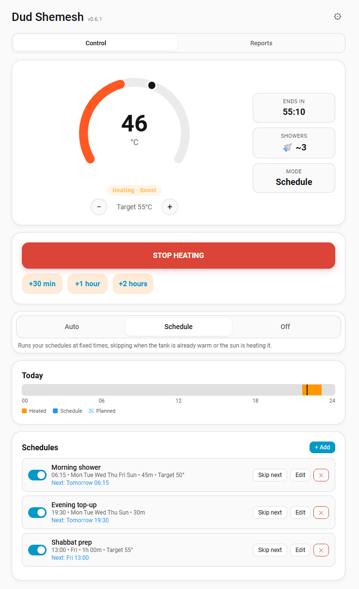
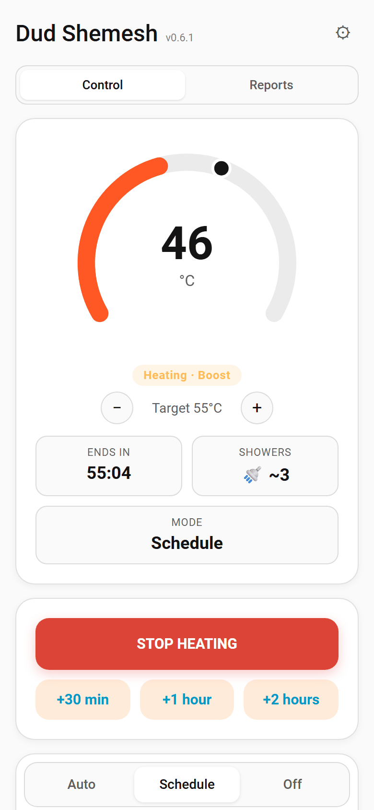
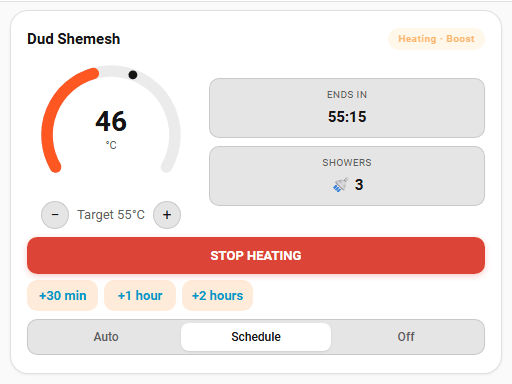

# Features

## Panel





- Circular gauge with a **drag-to-set** target marker and target minus/plus buttons. The gauge is also a keyboard slider (arrows, Page Up/Down, Home/End).
- Status badge: Ready, Heating, Waiting, Solar or Cold. While heating it shows the source of the run, for example "Heating · Boost".
- **Next heat** line, for example "Hot by 06:30" or "Morning shower · tomorrow 06:15, in 17h 20m".
- **Showers available** estimate, when the tank volume is set.
- Side pills: ends in, to target, showers, mode and the next anti-Legionella due date.
- **Boost** buttons. Boosting while the heater is running **extends** the current run instead of restarting it.
- Mode switch: Auto, Schedule, Off.
- Today timeline with past runs and planned heating.
- **Schedules**: time, days, duration and an optional target temperature. Each has an on/off switch, a next-run line and **skip next** (one holiday or away day).
- A tank picker in the header when you have more than one water heater.

## Smart layer

- **Auto mode**: pre-heat for comfort windows, timed with the tank's learned heating speed (°C/min from finished runs). Before enough runs exist it falls back to a physics estimate from tank volume and wattage.
- **Skip-if-warm**: a schedule with a target temperature is skipped when the tank is already there.
- **Solar gain detection**: a rolling temperature rise tells the integration the sun is heating, and electric runs are skipped.
- **Weather-aware skip**: current weather state, the hourly forecast, or a solar production forecast sensor.
- **Time-of-use prices**: auto pre-heat moves to the cheapest hours that still finish in time, and every run records its real cost.
- **Calendar one-off heat**: events on a chosen calendar start a heat run.
- **Vacation mode**: schedules suspended, tank held at an anti-mold temperature.
- **Shabbat mode**: with the Jewish Calendar integration, heats before candle lighting and can lock the controls and silence notifications until havdalah.
- **Cold warning**: 60 minutes before a comfort window, if the tank is cold and nothing is planned, you get a notification with a Boost button.
- **Anti-Legionella** cycle at a configurable temperature and interval. It is recorded as done only when the tank actually reaches the cycle temperature.

## Safety

- A heater switched on outside Dud Shemesh is adopted and turned off after a limit (default 60 min).
- Maximum run length (default 180 min) and over-temperature cutoff (default 75 °C).
- Stale sensor detection, with a `sensor_stale` notification.
- Heat-not-rising detection that flags an element or breaker fault.

## Reports


- "Saved this month" in ₪ from runs the sun made unnecessary, and a 30-day chart of electric versus avoided kWh.
- On-time, energy (kWh) and cost (₪) for today, 7 days and 30 days.
- Heater health: average °C/min trend.
- Run outcomes (completed, target reached, skipped and why, safety stops).
- Tank temperature chart from Home Assistant history, 24 hours or 7 days, with heating runs shaded.

## Entities

Each water heater is one device with these entities. Entity ids depend on your device name.

| Platform | Entities |
| -------- | -------- |
| `water_heater` | Target temperature, mode, away = vacation, on = heat now. |
| `button` | One per boost duration, stop heating, anti-Legionella now. |
| `select` | Mode (Auto, Schedule, Off). |
| `switch` | Heat now, vacation, anti-Legionella cycle. |
| `binary_sensor` | Heating, solar gaining, temperature sensor problem. |
| `sensor` | Status, tank temperature, minutes to target, energy. |

The status sensor has the attributes `current_temp`, `target_temp`, `active`, `next_heat_at`, `next_heat_source`, `next_heat_label`, `hot_by`, `showers_available`, `heat_rate_c_per_min` and `heat_rate_source` (`learned`, `physics` or `fallback`). The energy sensor is `total_increasing` in kWh and can be used in the Energy dashboard.

## Lovelace card



A compact gauge with target minus/plus, next heat, boost / extend / stop and the mode switch. It has a visual editor.

```yaml
type: custom:dud-shemesh-card
title: Water heater   # optional
# entry_id: <config entry id>   # optional: pick the water heater, default is the first
show_mode: true       # optional: show the mode switch
```

## Multiple water heaters

Add the integration more than once for a second heater or another home. Each entry runs its own scheduler and keeps its own data. The panel has a tank picker, the card has `entry_id`, and every service accepts an optional `entry_id`. Without it, a service acts on the first entry.

## Languages

The panel and card are available in English and Hebrew. With Home Assistant set to Hebrew the layout is right-to-left and the week starts on Sunday.
