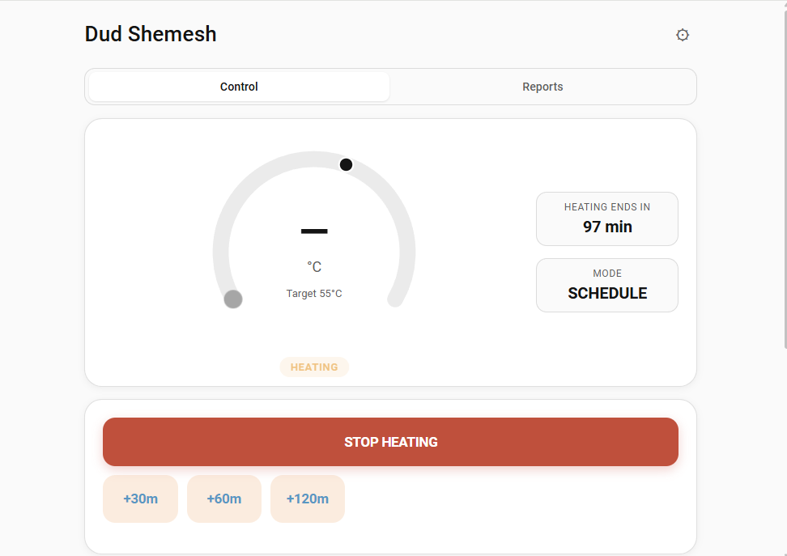
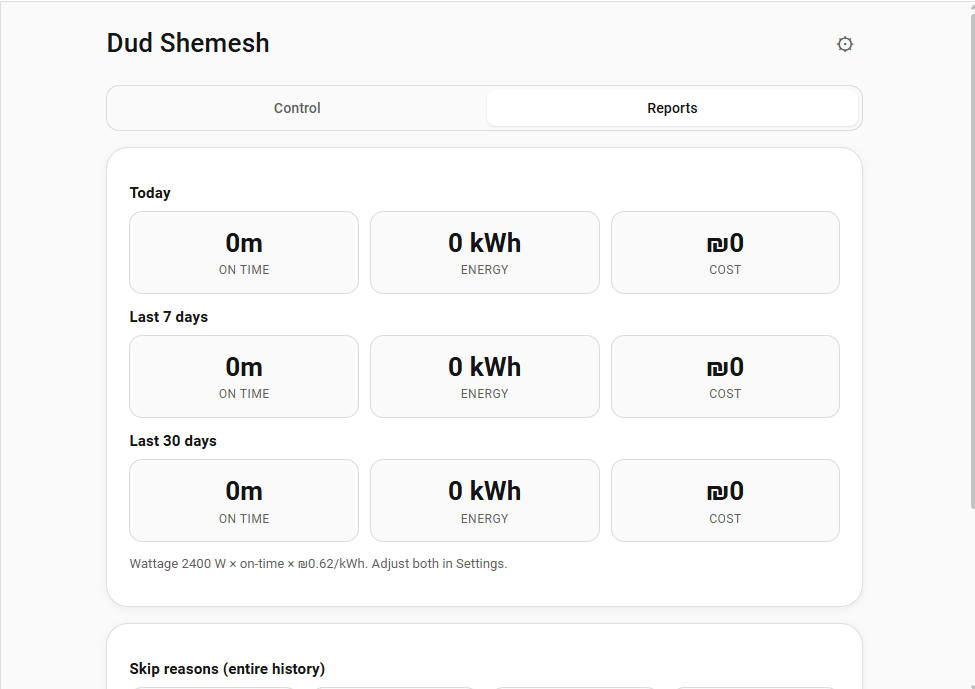

# דוד שמש

**אינטגרציה מותאמת אישית** ל-Home Assistant שהופכת מפסק חכם וחיישן טמפרטורה לבקר של דוד שמש עם גוף חימום חשמלי.

האינטגרציה מוסיפה לסרגל הצד פאנל עם מד גדול, כפתורי הפעלה מהירה בלחיצה אחת, לוחות זמנים, מצב אוטומטי שמחמם מראש לפני השעות שבהן צריך מים חמים, דוחות וכרטיס ל-Lovelace. הכול רץ בתוך Home Assistant, על הממסר והחיישן שכבר יש לכם.

## מה מקבלים

- **פאנל בסרגל הצד** עם מד מעגלי (גוררים את סמן היעד כדי לקבוע טמפרטורה), תג מצב, שורת "החימום הבא", כפתורי הפעלה מהירה, בורר מצב, ציר זמן להיום ולוחות זמנים.
- **מצב אוטומטי** שמחמם מראש לפי חלונות הנוחות שלכם, לפי קצב החימום שהוא למד מהפעלות קודמות, ומדלג על גוף החימום כשהשמש עושה את העבודה.
- **ישויות מובנות**: `water_heater`, כפתורים, בורר מצב, מתגים, חיישנים בינאריים וחיישנים, כולל חיישן אנרגיה ללוח המחוונים Energy של Home Assistant.
- **שירותים, אירועים ופקודות Assist** לאוטומציות שלכם ולשליטה בקול.
- **דוחות** של זמן פעולה, אנרגיה ועלות, וגרף טמפרטורת המיכל.
- **מגבלות בטיחות**: אורך הפעלה מרבי, ניתוק בחום יתר, זיהוי חיישן שהפסיק לדווח וזיהוי חימום שלא מעלה טמפרטורה.
- **כרטיס Lovelace** בשם `custom:dud-shemesh-card`.
- ממשק בעברית ובאנגלית, עם פריסה מימין לשמאל כשהשפה ב-Home Assistant היא עברית.

פירוט נוסף בעמוד [יכולות](features.md).

## דרישות

| דרישה | הערות |
| ----- | ----- |
| Home Assistant בגרסה **2024.7.0** ומעלה | הגרסה המינימלית שמוגדרת ב-`hacs.json`. |
| ממסר חימום | `switch.*` (או `input_boolean.*`) ששולט בגוף החימום החשמלי. |
| חיישן טמפרטורה במיכל | רשות. `sensor.*` מספרי במעלות צלזיוס. בלי חיישן האינטגרציה עובדת לפי שעון בלבד. |
| [HACS](https://hacs.xyz) | להתקנה המומלצת. אפשר גם להתקין ידנית. |

חלק מהיכולות משתמשות באינטגרציות אחרות, אם יש לכם אותן: ישות `weather`, יומן `calendar`, חיישן תחזית ייצור סולארי (למשל Forecast.Solar או Solcast), אינטגרציית הלוח העברי (Jewish Calendar) ושירותי `notify.*`. אף אחת מהן אינה חובה.

## הצעדים הבאים

1. [התקינו](install.md) את האינטגרציה והוסיפו אותה ב-Home Assistant.
2. עברו על אפשרויות ה[הגדרות](configuration.md).
3. קחו רעיונות מעמוד ה[דוגמאות](examples.md).
